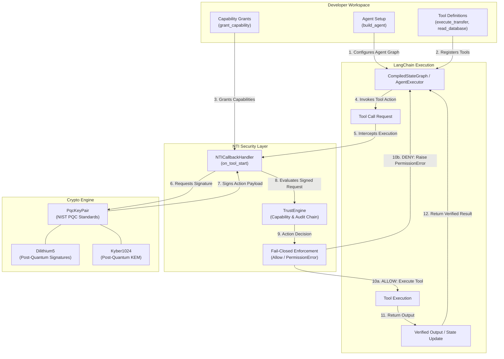

# NTI Secure Agent Template

A minimal working AI agent with **NTI (Neutral Trust Infrastructure)** post-quantum security pre-installed.

Every tool call is cryptographically verified before execution using all 5 pillars of NTI:
1. Zero-Trust Capability Enforcement
2. NIST Post-Quantum Cryptography (Dilithium5 / Kyber1024)
3. BFT Multi-Agent Consensus
4. Merkle-Chained Audit Trails
5. P2P Agent Mesh & State Persistence

## Quick Start

```bash
git clone https://github.com/abisheakp197/nti-agent-template.git my-agent
cd my-agent
pip install -e .
cp .env.example .env
# Add your OPENAI_API_KEY to .env
python agent.py
```

## What Just Happened

When you run `python agent.py`, two things occur:

1. Allowed action: `execute_transfer` was granted as a capability, so the transfer succeeds.
2. Blocked action: NTI raises `PermissionError` before any unauthorized tool runs.

This is the core value: agents cannot execute unauthorized actions, even if compromised at the prompt level.

## How To Add Capabilities

In `agent.py`, add a grant for any tool the agent should be allowed to call:

```python
nti_handler.grant_capability("execute_transfer")
nti_handler.grant_capability("read_database")
```

Any tool without an explicit grant is automatically blocked.

## Testing & Linting

Run tests and static analysis with:

```bash
pip install -e .[dev]
pytest
ruff check .
mypy --strict agent.py tests/test_agent.py
```

## Security

See [SECURITY.md](SECURITY.md) for security policies, disclosure procedures, and architectural details of NTI capability enforcement.

## License

MIT License. See [LICENSE](LICENSE).

## Links

- Core SDK: https://pypi.org/project/ube-foundation/
- LangChain wrapper: https://pypi.org/project/langchain-nti/
- Homepage: https://abisheakp197.github.io/Neutral-Trust-Infrastructure/

## Architecture


